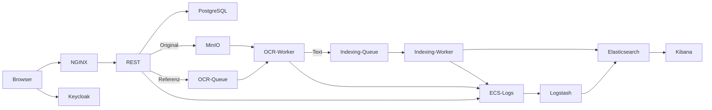

# SWEN3 Paperless

Semesterprojekt zur Verwaltung von Dokumentmetadaten und Kommentaren mit
asynchroner Übergabe hochgeladener Dateien an einen OCR-Worker.

## Funktionsumfang und aktueller Stand

- Anmeldung und Abmeldung über Keycloak.
- Dokumente hochladen und ihre Metadaten über die Dokument-ID abrufen.
- Dokumente einschließlich aller zugehörigen Kommentare löschen.
- Kommentare zu einem Dokument anlegen, lesen und löschen.
- Dateiinhalt nach dem Upload an RabbitMQ übergeben.
- REST speichert Originale; getrennte OCR- und Indexing-Worker erkennen und indexieren Text.

Der REST-Server speichert Originaldateien in MinIO und sendet eine Dokumentreferenz
an RabbitMQ. Der eigenstaendige OCR-Worker laedt das Original aus MinIO und erkennt
Text mit Tesseract/Poppler. Ein separater Indexing-Worker uebernimmt den OCR-Text aus
einer zweiten Queue und indexiert ihn mit dem Elasticsearch-Java-Client.
Elasticsearch, Logstash und Kibana starten gemeinsam mit der Anwendung.

Die vollstaendige [Sprint-4-Anleitung](docs/sprint-4.md) ordnet die Umsetzung allen
sieben Vorgaben zu und beschreibt den Nachrichtenvertrag, Tests und bekannte Grenzen.
Abgabe bleibt auf ausdruecklichen Wunsch **v0.3.0**; dieser Tag wird nach erfolgreicher
Pruefung auf den vervollstaendigten Stand aktualisiert. Der vorherige Ziel-Commit
`e8683a3fa015598e0982b85d255340202627323b` bleibt als historischer Nachweis erhalten.

## Voraussetzungen und Start

Für den vollständigen Docker-Betrieb werden Docker Desktop mit Linux-Containern,
Docker Compose und freie Ports aus der folgenden Tabelle benötigt. Beim ersten
Build ist Internetzugang zum Laden der Images und Java-Abhängigkeiten erforderlich.

Im Projektverzeichnis ausführen:

```powershell
docker compose up -d --build
docker compose ps
```

Danach [http://localhost:8081/](http://localhost:8081/) öffnen. Nach der
Weiterleitung zu Keycloak mit **user / user** anmelden. Beim ersten Start können
die Dienste etwas Zeit benötigen.

| Dienst | Adresse / Port auf dem Rechner | Aufgabe |
| --- | --- | --- |
| Frontend / NGINX | http://localhost:8081/ | Oberfläche und Weiterleitung der API-Aufrufe |
| REST-Server | http://localhost:8080/api/v1/documents | Authentifizierte Dokument-API |
| PostgreSQL | localhost:5434 | Metadaten und Kommentare |
| Keycloak | http://localhost:8082/ | Benutzerverwaltung und Anmeldung |
| RabbitMQ AMQP | localhost:5672 | Nachrichtentransport |
| RabbitMQ-Verwaltung | http://localhost:15672/ | Queues und Consumer beobachten |
| OCR-Worker | Kein eigener HTTP-Port | Original laden und Text erkennen |
| Indexing-Worker | Kein eigener HTTP-Port | OCR-Ergebnisse indexieren |
| MinIO S3 / Console | http://localhost:9000 / http://localhost:9001 | Originaldateien |
| Elasticsearch | http://localhost:9200 | OCR-Suchindex |
| Kibana | http://localhost:5601 | Dokumente und Logs untersuchen |
| Logstash API | http://localhost:9600 | Log-Pipeline pruefen |

Lokale Demo-Zugänge:

| Dienst | Benutzer | Passwort | Weitere Angabe |
| --- | --- | --- | --- |
| Frontend / Keycloak | user | user | Realm: paperless |
| Keycloak-Administration | admin | admin | Administration über Port 8082 |
| PostgreSQL | paperless | paperless | Datenbank: paperless |
| RabbitMQ | paperless | paperless | Virtueller Host: / |

Diese Zugangsdaten sind für die lokale Entwicklung gedacht. Keycloak importiert
die vorbereitete Konfiguration aus [paperless-realm.json](keycloak/paperless-realm.json).
Ein bereits vorhandener Realm wird beim erneuten Import nicht überschrieben.

Stoppen:

```powershell
docker compose down
```

PostgreSQL und RabbitMQ verwenden benannte Volumes; diese bleiben beim normalen
`down` erhalten. **`docker compose down -v` löscht diese gespeicherten Daten.**
Für Keycloak ist derzeit kein eigenes persistentes Daten-Volume konfiguriert.

## Bedienung

1. Anmelden und eine kleine Datei auswählen.
2. Hochladen; danach erscheinen Dokument-ID, Dateiname, Typ, Größe und Upload-Zeit.
3. Ein Dokument über die gemerkte Liste oder seine ID öffnen.
4. Kommentare mit Autor und Text hinzufügen oder einzeln löschen.
5. Über **Dokument löschen** nach Bestätigung das Dokument samt Kommentaren entfernen.

Die Dokumentliste wird im `localStorage` des jeweiligen Browsers gespeichert.
Sie ist keine vollständige serverseitige Liste und wird nicht automatisch mit
anderen Browsern synchronisiert. Der Kommentarautor wird frei eingegeben und
nicht aus dem angemeldeten Benutzer abgeleitet. Eine Zuordnung von Dokumenten zu
Benutzerkonten ist nicht implementiert.

### Upload-Limits

Im Backend gelten ohne eigene Konfiguration die Spring-Boot-Standardwerte:
**1 MB pro Datei** und **10 MB pro Multipart-Anfrage**. NGINX erlaubt zwar
50 MB pro Anfrage, das strengere Backend-Limit bleibt aber wirksam.
Eine Überschreitung im Backend liefert HTTP 413.

Der Dokumentvalidator prüft Dateiname, Content-Type und eine positive Dateigröße.
Eine Prüfung des tatsächlichen Dateiformats, beispielsweise einer PDF-Signatur,
ist nicht implementiert.

## Architektur und Entscheidungen

Der REST-Server verwendet eine **Feature-first-Drei-Schichten-Architektur**:
`document` und `comment` enthalten jeweils Controller, Geschäftslogik und Persistenz.
Gemeinsame Sicherheit, Fehlerbehandlung, Logging und Basis-Entities liegen in `common`.



- **Controller:** HTTP-Anfragen entgegennehmen, Request-Daten zuordnen und Antworten liefern.
- **Service:** Validierung, Existenzprüfungen, Zeitstempel und Anwendungsabläufe.
- **Persistenz:** Modelle in Entities übersetzen und über Repositories speichern.
- **DTO / Request:** Daten für die Kommunikation mit dem Browser.
- **Model:** Daten für die Geschäftslogik.
- **Entity:** Datenbankdarstellung einschließlich Beziehungen.
- **MapStruct:** erzeugt beim Kompilieren die Mapper zwischen den Darstellungen.
- **Interfaces und Adapter:** halten konkrete Datenbank- und RabbitMQ-Klassen aus dem Service heraus.
- **Spring Dependency Injection:** stellt Abhängigkeiten über Konstruktoren bereit;
  Lombok erzeugt viele dieser Konstruktoren.
- **PostgreSQL / JPA:** passen zu den strukturierten Daten und ihrer Dokument-Kommentar-Beziehung.
- **Frontend ohne Framework:** der aktuelle Umfang lässt sich direkt mit Browser-JavaScript umsetzen.
- **NGINX:** liefert statische Dateien aus und leitet `/api/` an `rest:8080` weiter.

Die [SecurityConfig](paperless-rest/src/main/java/at/fhtw/swen3/paperless_rest/common/security/SecurityConfig.java)
verlangt für alle API-Anfragen einen gültigen JWT. Der Browser verwendet
Authorization Code mit PKCE und sendet den Access-Token als
`Authorization: Bearer <token>`. Das Backend verwendet keine serverseitige
Login-Sitzung. Die Tokens liegen derzeit im `localStorage` des Browsers.

## Datenbank und Migrationen

| Tabelle | Inhalt |
| --- | --- |
| document | ID, Dateiname, Content-Type, Größe, Upload- und Audit-Zeitpunkte |
| comment | ID, Dokumentverknüpfung, Autor, Text und Audit-Zeitpunkte |
| flyway_schema_history | Historie der ausgeführten Datenbankmigrationen |

Ein Dokument kann mehrere Kommentare besitzen. `comment.document_id` ist ein
nicht leerer Fremdschlüssel auf `document.id`. Seit V4 entfernt PostgreSQL beim
Löschen eines Dokuments automatisch alle zugehörigen Kommentare
(`ON DELETE CASCADE`). Die Löschoperation läuft in einer Datenbanktransaktion.

Die [Flyway-Migrationen](paperless-rest/src/main/resources/db/migration) bauen das
Schema nachvollziehbar auf:

| Migration | Änderung |
| --- | --- |
| V1 | Dokumenttabelle anlegen |
| V2 | Kommentartabelle, Fremdschlüssel und Index anlegen |
| V3 | Audit-Spalten ergänzen und vorhandene Werte übernehmen |
| V4 | Automatisches Mitlöschen der Kommentare einrichten |

Bereits angewendete Migrationen unverändert lassen; weitere Änderungen gehören
in eine neue Migration. Hibernate prüft das Schema mit `ddl-auto=validate`.

`BaseEntity` stellt die generierte UUID bereit. `AuditableEntity` ergänzt
`createdAt` und `updatedAt`, die Hibernate über seine Zeitstempel-Annotationen
befüllt. Die Services setzen außerdem fachliche Zeitpunkte wie `uploadedAt`.
Im Java-Code wird `Instant` verwendet; die SQL-Spalten sind `TIMESTAMP` ohne
eigene Zeitzoneninformation. Eine explizite UTC-JDBC-Konfiguration fehlt noch.
Das Frontend stellt den Upload-Zeitpunkt in der lokalen Browserzeitzone dar.

## REST-API

Alle Endpunkte benötigen einen Bearer-Token. Ein Aufruf der API-Adresse in der
Browserzeile ersetzt weder eine Anmeldung noch einen Datei-Upload.

| Methode | Pfad | Ergebnis bei Erfolg |
| --- | --- | --- |
| POST | /api/v1/documents | Datei als Multipart-Feld `file` hochladen; 201 mit Metadaten |
| GET | /api/v1/documents/{id} | Metadaten lesen; 200 |
| DELETE | /api/v1/documents/{id} | Dokument samt Kommentaren löschen; 204 |
| POST | /api/v1/documents/{documentId}/comments | JSON mit `author` und `text` anlegen; 201 |
| GET | /api/v1/documents/{documentId}/comments | Kommentarliste lesen; 200, gegebenenfalls `[]` |
| DELETE | /api/v1/documents/{documentId}/comments/{commentId} | Kommentar löschen; 204 |

Die DELETE-Endpunkte sind idempotent: Bereits fehlende Einträge ergeben ebenfalls
204. Ein Kommentar wird nur gelöscht, wenn er zum angegebenen Dokument gehört.
Beim Anlegen und Lesen von Kommentaren führt ein fehlendes Dokument zu 404.

Der Kommentarvalidator verlangt Dokument-ID, nicht leeren Autor und nicht leeren
Text mit höchstens 1000 Zeichen. Die DTOs besitzen keine eigenen
Bean-Validation-Annotationen; die Prüfung erfolgt im Service über Validatoren.

Beispiel für das Anlegen eines Kommentars:

```json
{
  "author": "Demo",
  "text": "Dokument geprüft."
}
```

Weitere Beispiele stehen in [documents.http](documents.http) und
[documents-curl.txt](documents-curl.txt); ein gültiger Token muss ergänzt werden.
Die [OpenAPI-Datei](openapi.yaml) beschreibt bisher die Dokument-Endpunkte,
noch nicht die Kommentar-Endpunkte.

## RabbitMQ und Hintergrundverarbeitung

Der Upload speichert Metadaten in PostgreSQL und das Original unter seiner UUID im
MinIO-Bucket `documents`. Erst danach wird eine persistente Referenznachricht an
`paperless.ocr.v5` publiziert. Der OCR-Worker laedt das Original und publiziert den
erkannten Text nach `paperless.indexing.v1`. Der separate Indexing-Worker speichert
das Suchdokument in Elasticsearch. Jede Stufe bestaetigt erst nach Erfolg.

Beide Consumer besitzen begrenzte Retries und eine eigene dauerhafte Dead-Letter-Queue.
Nachrichtenvertraege, Upgrade von der alten Binaer-Queue und der praktische Test mit
gezielt gestoppten Workern sind in [Sprint 4](docs/sprint-4.md) beschrieben.

Datenbank, Objektspeicherung und Nachrichtenversand sind nicht atomar. Ein Outbox-Verfahren
fehlt. Bereits publizierte Arbeit wird bei einer Dokumentloeschung nicht storniert.

## Fehlerbehandlung und Logging

Der zentrale `GlobalExceptionHandler` übersetzt Exceptions in HTTP-Antworten.
Persistenz- und Messaging-Adapter erhalten die technische Ursache beim
Übersetzen in eigene Exceptions. Der Service hängt für OCR-Versandfehler nur
vom Fehlervertrag seines Publisher-Interfaces ab.

| Fehler | HTTP-Status |
| --- | --- |
| Ungültige Dokument-/Kommentardaten oder Anfrage | 400 |
| Anmeldung fehlt oder Token ungültig | 401 |
| Dokument oder Ressource nicht gefunden | 404 |
| Backend-Upload-Limit überschritten | 413 |
| Datenbankzugriff / Transaktion oder OCR-Versand fehlgeschlagen | 503 |
| Datei nicht lesbar oder unerwarteter Serverfehler | 500 |

Interne Ursachen und Stacktraces werden serverseitig protokolliert; die
allgemeinen technischen Fehlermeldungen an den Browser bleiben knapp.
Das Frontend zeigt Fehler über `showMessage()` an.

SLF4J dient als Logging-Schnittstelle, Logback übernimmt die Ausgabe.
`LoggingConfiguration` stellt den anfordernden Klassen passende Logger bereit.

- **INFO:** wichtige Aktionen, abgeschlossener Upload, Broker-Bestätigung und Worker-Verarbeitung.
- **DEBUG:** Datenbankzugriffe und technische Zwischenschritte.
- **WARN:** ungültige Eingaben, fehlende Dokumente und Versandprobleme.
- **ERROR:** technische Fehler mit Ursache im zentralen Handler.

```powershell
docker compose logs -f rest ocr-worker
```

Detaillierte Logs lokal mit `logging.level.at.fhtw.swen3=DEBUG` aktivieren.
Für Container kann `LOGGING_LEVEL_AT_FHTW_SWEN3=DEBUG` gesetzt werden.
Dateiinhalt, Kommentartext und Tokens werden nicht als reguläre
Anwendungs-Logfelder ausgegeben.

## Entwicklung in IntelliJ

Für lokale Backend-Entwicklung werden Java 21 und die abhängigen Dienste benötigt:

```powershell
docker compose up -d postgres rabbitmq keycloak
```

Danach `PaperlessRestApplication` aus `paperless-rest` starten:

- **IDE-REST:** http://localhost:8083/api/v1/documents
- **Docker-REST:** http://localhost:8080/api/v1/documents

Die getrennten Ports verhindern einen Konflikt bei parallelen Starts.
Das Docker-Frontend auf Port 8081 verwendet weiterhin das Docker-Backend;
Änderungen einer reinen IDE-Instanz müssen direkt über Port 8083 geprüft werden.

Für eine Datenbankansicht in IntelliJ: PostgreSQL-Datenquelle mit
Host `localhost`, Port `5434`, Datenbank `paperless` und den Demo-Zugangsdaten
anlegen. Die Tabellen liegen im Schema `public`.

## Tests und Teststrategie

JUnit 5 führt Tests aus, Mockito simuliert Abhängigkeiten und AssertJ prüft
Ergebnisse. Die Tests liegen unter
[paperless-rest/src/test/java](paperless-rest/src/test/java).

| Testart | Was wird geprüft? |
| --- | --- |
| Service-Unit-Tests | Geschäftsregeln, Zeitstempel und Aufrufe der gemockten Persistenz / Publisher |
| Validator- und Mapper-Tests | Pflichtfelder, Grenzen und Übertragung der Werte |
| Adapter-Unit-Tests | Mapping, Repository-Aufrufe und Fehlerübersetzung |
| Controller-Tests mit MockMvc | HTTP-Antworten und Anmeldung mit gemocktem Service |
| Repository-Integrationstests | Echte PostgreSQL-Zugriffe über Testcontainers, einschließlich Lösch-Cascade |
| Spring-Kontexttest | Laden der Anwendungskonfiguration |

Mocks isolieren die jeweilige Klasse. Testcontainers ergänzt echte
Datenbankprüfungen. Ein reproduzierbarer Test fuer REST, MinIO, beide Queues und Worker sowie ELK steht
mit `python scripts/smoke_pipeline.py` bereit. Ein automatisierter Browser-Test fehlt noch.

Mit laufendem Docker und den oben genannten lokalen Abhängigkeiten:

```powershell
cd paperless-rest
.\gradlew.bat test
```

Unter Linux/macOS entsprechend `./gradlew test` verwenden. JaCoCo erzeugt nach
dem Testlauf die Berichte:

- `paperless-rest/build/reports/tests/test/index.html`
- `paperless-rest/build/reports/jacoco/test/html/index.html`

Die aktuelle Coverage dem neu erzeugten Bericht entnehmen. `check` erzwingt
in allen drei Java-Modulen mindestens 71 % Zeilenabdeckung. GitHub Actions
prueft Backend, OCR-Worker und Indexing-Worker einschliesslich der Coverage-Grenzen.

Falls Windows Gradle wegen einer Loopback-Verbindung nicht starten kann, können
die Tests mit Java 21 im Docker-Build-Image ausgeführt werden. Befehle aus dem
Projekt-Hauptverzeichnis:

```powershell
docker build --target build -t paperless-rest-tests ./paperless-rest
docker run --rm -v /var/run/docker.sock:/var/run/docker.sock -e TESTCONTAINERS_HOST_OVERRIDE=host.docker.internal -e SPRING_DATASOURCE_URL=jdbc:postgresql://host.docker.internal:5434/paperless -e SPRING_RABBITMQ_HOST=host.docker.internal paperless-rest-tests ./gradlew test --no-daemon --console=plain
```

Bei dieser Variante bleiben Berichte ohne zusätzlichen Export nicht auf dem
Host erhalten. Der normale Compose-Build überspringt die Backend-Tests und ist
daher kein Ersatz für einen Testlauf.

### Bisherige praktische Prüfungen

Am 04.11.2026 wurden der Docker-Build von REST und UI, der vollständige
Backend-Testlauf sowie ein authentifizierter Löschablauf erfolgreich geprüft:
Ein eigens angelegtes Dokument mit zwei Kommentaren wurde gelöscht und die
Entfernung der Kommentare direkt in PostgreSQL kontrolliert. Ein erneuter
Löschaufruf ergab ebenfalls 204. Die Dateiübergabe bis zum Worker-Log wurde
bereits am 03.11.2026 erfolgreich geprüft. Dies sind dokumentierte frühere
Prüfungen, keine Garantie für einen später veränderten Stand.

## GitHub, Aufgaben und GitFlow

- [Repository](https://github.com/kokoloko99/swen3-paperless)
- [Issues](https://github.com/kokoloko99/swen3-paperless/issues?q=is%3Aissue)
- [Kanban-Board](https://github.com/users/kokoloko99/projects/2)
- [Pull Requests](https://github.com/kokoloko99/swen3-paperless/pulls)
- [Changelog](CHANGELOG.md)

Issues beschreiben Aufgaben und Abnahmekriterien. Im Board zeigen **Todo**,
**In Progress** und **Done** den Bearbeitungsstand. Frühere Aufgaben wurden
teilweise nachträglich erfasst und sind entsprechend gekennzeichnet.

GitFlow wurde nach den ursprünglichen direkten Pushes eingerichtet. Die folgende
Tabelle beschreibt den vereinbarten Ablauf; frühere Commits werden nicht
rückwirkend als Branch- oder PR-Arbeit dargestellt.

| Branch | Zweck | Pull-Request-Ziel |
| --- | --- | --- |
| main | Stabiler Abgabestand | — |
| develop | Gemeinsamer Entwicklungsstand | — |
| feature/<name> | Neue Funktion, aus develop erstellen | develop |
| release/<version> | Abgabe vorbereiten, aus develop erstellen | main; anschließend main zurück nach develop |
| hotfix/<name> | Dringenden Fehler beheben, aus main erstellen | main; anschließend main zurück nach develop |

```sh
git switch develop
git pull --ff-only origin develop
git switch -c feature/meine-funktion
# Änderung implementieren und prüfen
git add <geänderte-dateien>
git commit -m "Describe the change"
git push -u origin feature/meine-funktion
```

Danach einen Pull Request nach `develop` öffnen, vom Kollegen prüfen lassen und
über **Create a merge commit** zusammenführen. Das
[PR-Template](.github/pull_request_template.md) unterstützt die Beschreibung.

Für eine Abgabe einen Release-Branch erstellen, prüfen und per PR nach `main`
übernehmen. Auf dem freigegebenen Stand einen neuen Versions-Tag setzen und die
Änderungen per PR von `main` nach `develop` zurückführen.
Veröffentlichte Tags künftig nicht verschieben, sondern neue Versionen vergeben.

Abgabe Sprint 4: **v0.3.0**. Alle drei Gradle-Projekte verwenden Version `0.3.0`.
Der [Pruefnachweis vom 25.11.2026](docs/verification-2026-11-25.md) dokumentiert
Tests, Coverage und den praktischen OCR-/Elasticsearch-Test.

## Erfahrungen und offene Punkte

- Getrennte IDE-/Docker-Ports verhindern, dass zwei REST-Instanzen um Port 8080 konkurrieren.
- Eine leere Queue bedeutet nicht, dass kein Upload stattgefunden hat:
  Der schnelle Worker kann Nachrichten sofort abholen; zum Vorführen den Worker kurz stoppen.
- Erst ein Datenbank-Integrationstest bzw. eine direkte Datenbankprüfung weist das
  Mitlöschen von Kommentaren nach; eine erfolgreiche HTTP-Antwort allein reicht dafür nicht.
- Broker-Bestätigung und Datenbank-Commit sind unterschiedliche Schritte und keine
  atomare Gesamttransaktion.

Fuer die Weiterentwicklung fehlen insbesondere automatisierte End-to-End-Tests,
ein transaktionales Outbox-Verfahren sowie eine koordinierte Loeschung von
Metadaten, Originaldatei und Suchindex. Die Kommentare-Endpunkte sind noch
in die OpenAPI-Beschreibung aufzunehmen.
