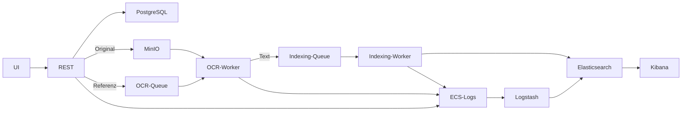

# SWEN3 Paperless

Dokumentenverwaltung mit REST-API, Weboberfläche, OCR und Volltextindex.
Abgabeversion: **v0.3.0**. Java 21 und Spring Boot.

## Start

Docker Desktop mit Linux-Containern und Docker Compose starten. Im Projektordner:

```powershell
docker compose up -d --build
docker compose ps
```

Die [Weboberfläche](http://localhost:8081) öffnen und mit **user / user** anmelden.
Beim ersten Start werden Images und Abhängigkeiten geladen; Kibana kann etwas Zeit benötigen.
Stoppen mit `docker compose down`. Benannte Volumes bleiben erhalten;
`docker compose down -v` löscht deren Daten.

## Dienste und lokale Zugänge

| Dienst | Adresse | Zugang |
| --- | --- | --- |
| Weboberfläche | http://localhost:8081 | user / user |
| REST | http://localhost:8080/api/v1/documents | Bearer-Token |
| Keycloak | http://localhost:8082 | admin / admin; Realm paperless |
| PostgreSQL | localhost:5434 | paperless / paperless; Datenbank paperless |
| RabbitMQ AMQP / Verwaltung | localhost:5672 / http://localhost:15672 | paperless / paperless |
| MinIO S3 / Console | http://localhost:9000 / http://localhost:9001 | paperless / paperless-secret |
| Elasticsearch | http://localhost:9200 | Ohne Anmeldung im lokalen Setup |
| Kibana | http://localhost:5601 | Dokumente und Logs untersuchen |
| Logstash API | http://localhost:9600 | Pipeline-Statistiken |

Die Zugänge dienen der lokalen Entwicklung. MinIO-Zugangsdaten lassen sich mit
`MINIO_ROOT_USER` und `MINIO_ROOT_PASSWORD` ersetzen. OCR und Indexierung laufen
als eigenständige Worker ohne HTTP-Port. Die lokale REST-Entwicklung verwendet
Port 8083; Docker verwendet 8080.

## Funktionsumfang

- Anmeldung mit Keycloak über Authorization Code und PKCE.
- Dokumente hochladen, Metadaten abrufen und Dokumente samt Kommentaren löschen.
- Kommentare zu einem Dokument anlegen, lesen und löschen.
- Originaldateien in MinIO speichern.
- Text aus PDF, PNG, JPEG und TIFF mit Tesseract erkennen; PDFs mit Poppler vorbereiten.
- OCR-Ergebnisse über einen separaten Worker in Elasticsearch indexieren.
- Anwendungslogs mit Logstash nach Elasticsearch übertragen und in Kibana untersuchen.

Die im Browser angezeigte Dokumentliste liegt im localStorage und ist keine
vollständige serverseitige Liste. Der Kommentarautor wird frei eingegeben.
Ein Suchfeld in der Weboberfläche ist noch nicht implementiert.

## Architektur

Der REST-Server ist nach Features und innerhalb der Features in Controller,
Geschäftslogik und Persistenz gegliedert. Interfaces trennen Services von Adaptern.
MapStruct übernimmt das Mapping, Spring die Konstruktorinjektion. PostgreSQL/JPA
speichert Metadaten und Kommentare; Flyway verwaltet die Datenbankmigrationen.



Anforderungen, Nachrichtenverträge und Fehlerbehandlung: [Sprint 4](docs/sprint-4.md).

## REST-API

Alle Endpunkte erfordern einen JWT im Header `Authorization: Bearer <token>`.

| Methode | Pfad | Ergebnis |
| --- | --- | --- |
| POST | /api/v1/documents | Multipart-Feld file hochladen; 201 |
| GET | /api/v1/documents/{id} | Metadaten; 200 |
| DELETE | /api/v1/documents/{id} | Dokument und Kommentare löschen; 204 |
| POST | /api/v1/documents/{id}/comments | JSON mit author und text; 201 |
| GET | /api/v1/documents/{id}/comments | Kommentarliste; 200 |
| DELETE | /api/v1/documents/{id}/comments/{commentId} | Kommentar löschen; 204 |

Beispiele: [documents.http](documents.http). [openapi.yaml](openapi.yaml) beschreibt
bisher die Dokument-Endpunkte; die Kommentar-Endpunkte sind noch zu ergänzen.
DELETE ist idempotent. Ungültige Angaben liefern 400, fehlende Anmeldung 401,
fehlende Ressourcen 404 und technische Speicher-/Versandfehler 503.

## Tests und Coverage

Mit laufendem Docker, PostgreSQL und RabbitMQ:

```powershell
.\paperless-rest\gradlew.bat -p paperless-rest check
.\paperless-rest\gradlew.bat -p paperless-ocr-worker check
.\paperless-rest\gradlew.bat -p paperless-indexing-worker check
```

Unter Linux/macOS `bash paperless-rest/gradlew` statt der BAT-Datei verwenden.
JUnit und Mockito prüfen Geschäftslogik, Adapter, Nachrichtenverträge und Fehlerfälle.
MockMvc prüft die API; Testcontainers prüft PostgreSQL einschließlich Kommentar-Cascade.
`check` erzwingt in jedem Modul mindestens **71 % Zeilenabdeckung**.
GitHub Actions führt alle drei Module aus und stellt die Berichte als Artefakte bereit.

Berichte je Modul: `build/reports/tests/test/index.html` und
`build/reports/jacoco/test/html/index.html`.

## Entwicklung und Abgabe

- [Repository](https://github.com/kokoloko99/swen3-paperless)
- [Issues](https://github.com/kokoloko99/swen3-paperless/issues)
- [Kanban-Board](https://github.com/users/kokoloko99/projects/2)
- [Release v0.3.0](https://github.com/kokoloko99/swen3-paperless/releases/tag/v0.3.0)
- [Changelog](CHANGELOG.md)

GitFlow: Feature-Branches gehen per PR nach develop, Release-Branches nach main;
anschließend wird main per PR nach develop zurückgeführt. Merge-Commits erhalten
die Branch-Historie. Die PR-Vorlage liegt unter `.github/pull_request_template.md`.

## Erfahrungen

Eine Broker-Bestätigung sichert den Nachrichtenversand ab, aber nicht den Abschluss
der Verarbeitung. Dafür sind die Logs und der Suchindex zu prüfen. Eine leere Queue
kann bedeuten, dass der Consumer den Auftrag bereits verarbeitet hat.

## Grenzen

- Standard-Upload-Limits: 1 MB je Datei und 10 MB je Anfrage.
- Validierung der Metadaten, aber keine vollständige Dateiformat-Signaturprüfung.
- Löschen entfernt Metadaten und Kommentare, aber noch nicht MinIO-Originale oder
  Elasticsearch-Einträge; wartende Verarbeitung wird nicht storniert (#25).
- Such-REST-API und Suchfeld fehlen (#26); direkte Elasticsearch-Suche ist möglich.
- Datenbank, MinIO und Queue-Versand sind nicht atomar; ein Outbox-Verfahren fehlt.
- Tokens und die gemerkte Dokumentliste liegen im localStorage des Browsers.
