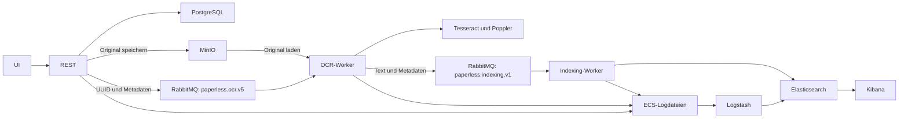

# Sprint 4: alle sieben Anforderungen

Abgabeversion: **v0.3.0**. Dieser Stand vervollstaendigt die zuerst veroeffentlichte
Version auf ausdruecklichen Wunsch unter demselben Tag. Der vorherige Tag zeigte
auf Commit `e8683a3fa015598e0982b85d255340202627323b`; dieser Commit bleibt in der Historie.
Der neue Ziel-Commit wird nach bestandenen Pruefungen im GitHub Release ausgewiesen.

## Anforderungen und Umsetzung

| Nr. | Vorgabe | Umsetzung |
| --- | --- | --- |
| 1 | Eigene Anwendungen fuer Worker | Zwei Spring-Boot-Anwendungen: paperless-ocr-worker und paperless-indexing-worker |
| 2 | Tesseract und Ghostscript oder Alternative | Tesseract eng+deu; Poppler/pdftoppm rendert alle PDF-Seiten bei 200 DPI |
| 3 | REST speichert PDF in MinIO | DocumentService speichert Originalbytes nach Metadatenvalidierung und vor Queue-Versand |
| 4 | OCR laedt Original aus MinIO | Queue enthaelt UUID-Referenz; OCR-Worker laedt Original, erkennt Text und sendet Ergebnis |
| 5 | Elasticsearch im Worker-Service | Offizieller Java-Client 9.4.1 im Indexing-Worker, per Dependency Injection |
| 6 | Indexing-Worker speichert OCR-Text | Eigene Ergebnis-Queue und eigener Container; Indexierung nach Validierung und mit stabiler UUID |
| 7 | MinIO, OCR und ELK in Docker | MinIO, beide Worker, Elasticsearch, Logstash und Kibana starten standardmaessig mit Compose |



## Nachrichtenvertraege

Beide Nachrichten sind persistent, nutzen UTF-8 und `schemaVersion=1`.
Nachrichtentypen besitzen getrennte Queues; es wird kein PDF-Binaerinhalt mehr transportiert.

| Queue | Body | Header |
| --- | --- | --- |
| paperless.ocr.v5 | kanonische Dokument-UUID, zugleich MinIO-Objektschluessel | documentId, filename, originalContentType, schemaVersion |
| paperless.indexing.v1 | erkannter OCR-Text; auch leer bei leeren Seiten erlaubt | documentId, filename, originalContentType, schemaVersion |

AMQP Content-Type ist jeweils `text/plain`; der urspruengliche Dateityp steht im
Header `originalContentType`. Der Bucket heisst `documents`. Die UUID dient in
MinIO und Elasticsearch als stabiler Schluessel; wiederholte Verarbeitung ersetzt
denselben Suchindex-Eintrag statt Duplikate anzulegen.

Das Elasticsearch-Mapping definiert `id` und `contentType` als keyword, `filename`
und `text` als text. Der Index `paperless-documents` wird beim ersten Ergebnis angelegt.
Der OCR-Worker hat keine Elasticsearch-Abhaengigkeit; der Indexing-Worker benoetigt
weder MinIO noch Tesseract. Dadurch laesst sich die Indexierung eigenstaendig wiederholen.

## Start und Zugaenge

```powershell
docker compose up -d --build
docker compose ps
docker compose logs --tail 30 rest ocr-worker indexing-worker logstash
```

| Dienst | Adresse | Demo-Zugang |
| --- | --- | --- |
| Weboberflaeche | http://localhost:8081 | user / user |
| Keycloak | http://localhost:8082 | admin / admin |
| REST | http://localhost:8080/api/v1/documents | Bearer-Token |
| MinIO S3 / Console | http://localhost:9000 / http://localhost:9001 | paperless / paperless-secret |
| RabbitMQ-Verwaltung | http://localhost:15672 | paperless / paperless |
| Elasticsearch | http://localhost:9200 | lokale Uebung ohne Elastic-Authentifizierung |
| Kibana | http://localhost:5601 | Elasticsearch-Daten erkunden |
| Logstash API | http://localhost:9600 | Pipeline-Statistiken |

MinIO-Zugang ist durch `MINIO_ROOT_USER` und `MINIO_ROOT_PASSWORD` ueberschreibbar.
Das MinIO-Image stammt von einem per Digest fixierten Community-Mirror, da die
bisherigen offiziellen Registry-Images beim ersten Aufbau nicht abrufbar waren.
Elasticsearch, Logstash und Kibana verwenden gemeinsam 9.4.1.

## ELK-Logfluss

Spring Boot schreibt strukturierte ECS-JSON-Logs fuer REST und beide Worker in das
Volume `application-logs`. Logstash liest diese Dateien ueber die Pipeline
`logstash/pipeline/paperless.conf`, merkt sich Lesepositionen im Volume `logstash-data`
und schreibt Ereignisse nach `paperless-logs-*` in Elasticsearch. Der OCR-Suchindex
bleibt `paperless-documents` und wird direkt durch den Java-Client geschrieben.

In Kibana unter Discover eine Data View fuer `paperless-documents` (ohne Zeitfeld)
oder `paperless-logs-*` (Zeitfeld `@timestamp`) anlegen. Das Skript unten prueft auch,
dass Logs zur Testdokument-ID von REST und beiden Workern im Logindex angekommen sind.

## Tests

```powershell
.\paperless-rest\gradlew.bat -p paperless-rest clean check bootJar
.\paperless-rest\gradlew.bat -p paperless-ocr-worker clean check bootJar
.\paperless-rest\gradlew.bat -p paperless-indexing-worker clean check bootJar
python -m pip install -r scripts/requirements-smoke.txt
python scripts/smoke_pipeline.py
```

`check` erzwingt mindestens 71 % JaCoCo-Zeilenabdeckung je gesamtem Java-Modul.
Alle drei Anwendungen werden in GitHub Actions geprueft. Test- und Coverage-Berichte
liegen in den jeweiligen `build/reports`-Verzeichnissen und als CI-/Release-Artefakte.

Der praktische Smoke-Test stoppt beide Worker, laedt eine zweiseitige PDF und ein PNG
hoch und vergleicht die bereits durch REST gespeicherten MinIO-Originale bytegenau.
Er prueft die Referenznachrichten, startet nur OCR und kontrolliert die wartenden
Textergebnisse. Erst dann startet er den Indexing-Worker, prueft Volltextsuche,
Kibana und den echten Logstash-Logfluss. Er entfernt nur seine eigenen Testdokumente
und startet beide Worker abschliessend wieder. Bei einem Fehler bleiben die eigenen
Testdaten fuer die Diagnose erhalten. Bereits wartende Arbeit muss vor dem Test
abgearbeitet sein; das Skript prueft zu Beginn beide Queues.

## Fehler und Upgrade

- Beide Consumer bestaetigen erst nach ihrem erfolgreichen Verarbeitungsschritt.
- OCR wartet vor dem ACK auf die RabbitMQ-Bestaetigung der Ergebnisnachricht.
- Pro Consumer hoechstens eine unbestaetigte Nachricht; Fehler werden maximal dreimal
  mit exponentieller Wartezeit versucht. Dead-Letter-Queues heissen jeweils `<queue>.dead`.
- Ungueltige Referenzen, Metadaten und nicht dekodierbarer UTF-8-Ergebnistext werden abgelehnt.
- Tesseract/Poppler haben je Kommando ein Zwei-Minuten-Limit; temporaere Dateien werden aufgeraeumt.
- REST meldet MinIO-Ausfaelle mit HTTP 503 und sendet keinen OCR-Auftrag fuer fehlgeschlagene Speicherung.
- Vor dem Upgrade alte `paperless.ocr.v4`-Auftraege mit dem alten Worker abarbeiten.
  Der neue Vertrag benutzt bewusst `paperless.ocr.v5`; alte Nachrichten werden nicht umgedeutet.
- PostgreSQL, MinIO, Elasticsearch, Logs und Logstash-Lesepositionen besitzen persistente
  Volumes. `docker compose down -v` entfernt deren Daten.

## Weiterhin offene Folgeaufgaben

- #25: Dokumentloeschung entfernt Metadaten und Kommentare, aber nicht automatisch
  das Original in MinIO oder den Elasticsearch-Eintrag; wartende Arbeit wird nicht storniert.
- #26: Such-REST-API und Suchfeld in der bestehenden Oberflaeche fehlen noch.
- Datenbank, MinIO und RabbitMQ bilden keine atomare Transaktion. Wenn Versand oder Commit
  nach der Objektspeicherung fehlschlaegt, kann ein verwaistes Objekt zurueckbleiben.
  Ein transaktionales Outbox-Verfahren ist noch nicht umgesetzt.
- Die bestehenden Backend-Upload-Limits bleiben unveraendert. Bei sehr grossen oder
  defekten PDFs ist das Zeitlimit pro Kommando keine Gesamtlaufzeit-/Speichergrenze.

## Historische Nachweise

Die frueheren Berichte `verification-2026-11-25.md` und die urspruenglichen vier
Exercise-Issues beschreiben den zuerst geprueften Stand. Sie ersetzen nicht den
Pruefbericht fuer diese anschliessend vorgelegte Sieben-Punkte-Liste.
Aktueller Nachweis: [Pruefung aller sieben Vorgaben](verification-seven-requirements-2026-11-25.md).

## Technische Referenzen

- Spring Boot ECS-Dateilogs: https://docs.spring.io/spring-boot/reference/features/logging.html
- Logstash file input: https://www.elastic.co/docs/reference/logstash/plugins/plugins-inputs-file
- Elasticsearch Java-Client: https://www.elastic.co/docs/reference/elasticsearch/clients/java/setup/installation
